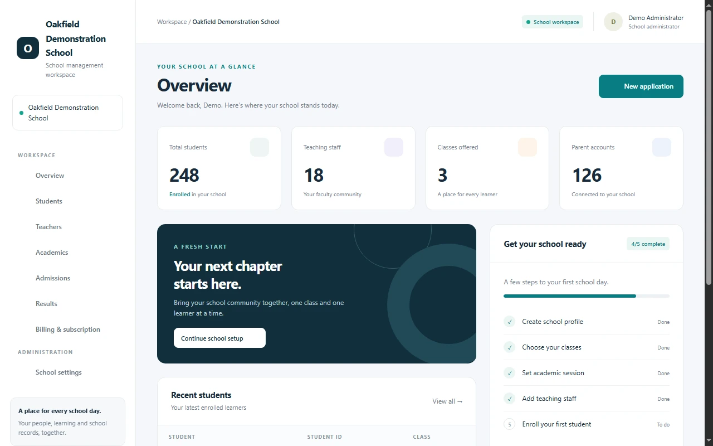

<div align="center">
  <h1>edunaij</h1>
  <p><strong>School management for Nigerian schools</strong></p>
  <p>Manage admissions, classes, learning and school records in one workspace.<br>Oversee school organisations, subscriptions and release announcements from a separate platform dashboard.</p>
  <p><code>Python 3.14</code> · <code>Django 6.0</code> · <code>Active development</code></p>
  <p><a href="#school-workflow">School workflow</a> · <a href="#roadmap">Roadmap</a> · <a href="#run-locally">Run locally</a> · <a href="#developer-and-partnerships">Partnerships</a></p>
</div>


## What edunaij does

edunaij is a multi-tenant Django application. Each school has its own workspace and access rules. Platform owners manage schools and plans from a separate host. Staff can work with applications, student records and class setup without moving between separate tools.

| Workspace | What you can do |
| --- | --- |
| **Platform owner** | Review school registrations, manage organisations and plans, suspend or restore school access, and publish release announcements. |
| **School administration** | Configure the school profile, academic session and offered classes. Manage staff, admissions, student records and results. |
| **Teachers and learners** | Create assignments, submit work, grade submissions and share feedback. Access is scoped to the school and applicable class relationships. |
| **Parents and guardians** | View information for linked children in their school. |

<details open>
<summary><strong>Preview the school dashboard</strong></summary>
<br>

<p><em>Screenshot from the application using fictional school records.</em></p>
</details>

## School workflow

1. **Submit a registration request.** The form collects school ownership and level, state or FCT, LGA or area council, campus address and an authorised contact. It records applicable CAC registration and education approval details separately. Schools can report pending applications, and public schools can leave CAC details blank.
2. **Review and set up the workspace.** The platform owner reviews requests and coordinates access. Workspace creation and school administrator assignment are currently manual. The school uses a separate hostname configured for its tenant.
3. **Configure classes and start work.** The school administrator sets up the academic session and classes, adds staff and enrols students. Teachers and guardians receive access through their assigned roles and relationships.

## Roadmap

The six phases below summarise the project's engineering roadmap against the current application. The final column identifies work that still needs delivery or verification.

| Phase | What the project has built | Remaining work or verification |
| --- | --- | --- |
| **01 · Tenant foundation** | School organisations, domain routing and school-scoped access to records and files. | Extend automated coverage across school roles and high-risk data flows. |
| **02 · Account security** | Separate platform and school administration, sign-in throttling, audit records and authenticator-app MFA with recovery codes. | Validate access, account recovery and administrator enrolment in the deployment environment. |
| **03 · School onboarding** | Public registration, a private review queue, school profile and class setup, and domain management. School and official email addresses can be reserved under a configured domain. | Connect approval to workspace creation and invitations. Integrate a mail provider to provision inboxes or forwarding for reserved addresses. |
| **04 · Subscription lifecycle** | Plans, subscription status, manual suspension and reactivation, and Paystack callback validation with payment matching. | Verify live billing and reconcile provider subscription events. Recurring billing remains a separate integration task. |
| **05 · School capabilities** | Guardian access, assignments and grading, results, PDF reports and in-app announcements. | Continue work on attendance, reporting, accessibility and end-to-end school workflows. |
| **06 · Production hardening** | Secure settings, monitoring hooks, backup tooling and local restore verification. | Validate the hosted stack, production backup and recovery, and a full school pilot before a wider rollout. |

Release announcements are published from the platform dashboard. Application deployments run through the hosting pipeline. Legacy Stripe, SSLCommerz and Braintree checkout paths remain disabled pending verification.

## Run locally

The tested development environment uses **Python 3.14.4** and **Django 6.0.8**. It uses SQLite, an in-memory cache and synchronous background tasks.

```powershell
git clone https://github.com/Lureocreatives2/Edunaij-School-Portals.git
cd Edunaij-School-Portals
py -3.14 -m venv .venv
.venv/Scripts/python.exe -m pip install -r requirements.txt
.venv/Scripts/python.exe scripts/setup_local.py
.venv/Scripts/python.exe manage.py migrate
.venv/Scripts/python.exe manage.py createsuperuser
.venv/Scripts/python.exe manage.py runserver 127.0.0.1:8000
```

On macOS or Linux, create the environment with `python3.14 -m venv .venv` and use `.venv/bin/python` for the remaining Python commands.

| Open | Local address |
| --- | --- |
| Public landing page and product tour | [127.0.0.1:8000](http://127.0.0.1:8000/) |
| School registration | [/platform/register/](http://127.0.0.1:8000/platform/register/) |
| Platform sign-in | [/platform/login/](http://127.0.0.1:8000/platform/login/) |
| Advanced administration | [/admin/](http://127.0.0.1:8000/admin/) after platform sign-in |

The setup helper creates `envs/.env` with a unique secret and preserves existing configuration. The ZIP contains source only. Create a superuser locally and configure a separate allowed school hostname before testing school accounts. The sample reserves `localhost` and `127.0.0.1` for the platform. Set `ADMIN_MFA_REQUIRED=True` to exercise mandatory administrator enrolment locally. Local email is printed to the terminal.

## Verify and package

```powershell
.venv/Scripts/python.exe scripts/check_project.py
.venv/Scripts/python.exe scripts/package_source.py
```

The packaging script builds a ZIP, file manifest and SHA256 checksum under `dist/`. It excludes local environments, databases, uploads, backups and internal reports.

[Architecture](docs/public/ARCHITECTURE.md) · [Deployment checklist](docs/public/DEPLOYMENT.md) · [GitHub publishing](docs/public/GITHUB.md) · [Contributing](CONTRIBUTING.md) · [Security reporting](SECURITY.md)

## Developer and partnerships

**Developed by Adeshina Opeyemi.** For school onboarding, a product walkthrough or a partnership, email [opeyemiolamide882@gmail.com](mailto:opeyemiolamide882@gmail.com). Developer profile: [Lureocreatives2](https://github.com/Lureocreatives2).

**All rights reserved.** See [LICENSE](LICENSE) for project terms and [third-party notices](THIRD_PARTY_NOTICES.md) for bundled components.
